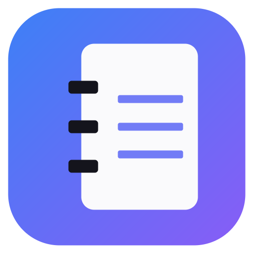

# Chethiya Rathnasekara

**Software Engineer & AI Engineer** · Sri Lanka

Building high-performance desktop platforms, deep-learning pipelines and full-stack systems — tools that work fast and feel good.

 

&nbsp;

Available for software & AI engineering roles · 2026

---

### Featured Project

<table>
  <tr>
    <td width="80" align="center" valign="middle">
      
    </td>
    <td>
      <a href="https://damsarachethiyaa-dev.github.io/github-portfolio/traders-journal/"><strong>Traders Journal</strong></a> — <em>Privacy-first trading workstation for Windows</em>
        
      Electron + Node.js desktop app syncing live MetaTrader 5 deals in &lt;100ms via a custom MQL5 Expert Advisor over local loopback. Features a PnL calendar, 4-tab advanced analytics, market sessions and per-user salted scrypt encryption — 100% offline with zero cloud telemetry.
        
      
      &nbsp;
      
      &nbsp;
      
    </td>
  </tr>
</table>

---

### Selected Work

| Project | What it is | Stack |
| --- | --- | --- |
| [**Orbit**](https://damsarachethiyaa-dev.github.io/orbit/) · [download](https://github.com/damsarachethiyaa-dev/orbit/releases) | Paste-a-link video & audio downloader for Windows and Android — 1000+ sites, up to 4K, MP3, auto-update | Python, Flask, pywebview, Kotlin, yt-dlp, FFmpeg |
| [**Lumi Keys**](https://damsarachethiyaa-dev.github.io/lumi-keys/) · [download](https://github.com/damsarachethiyaa-dev/lumi-keys/releases/latest) | AMOLED Android AI keyboard — Gboard-style typing, Sinhala & Singlish, smart clipboard, AI with your own key | Kotlin, Android IME, three.js |
| **Orbit Media Studio** *(private)* | Full-stack PWA for media processing — video/audio downloader, batch queue and watermark studio | Next.js 15, TypeScript, FFmpeg, Docker |
| [**POS & Inventory**](https://github.com/damsarachethiyaa-dev/POS-Inventory-Management-System) | Java desktop suite for checkout, stock and reporting | Java Swing, FlatLaf, MySQL, JasperReports |
| [**ScreenToChatGPT**](https://github.com/damsarachethiyaa-dev/Screen-Capture) | Multi-monitor screen capture with GPT-4o visual analysis | Python, PyWin32, GPT-4o API, Electron |
| **4K AI Upscaler** | CUDA-accelerated super-resolution pipeline (experimental) | Python, PyTorch, CUDA, Real-ESRGAN, FFmpeg |

---

### Tech Stack & Skills

#### Desktop & Systems

#### AI & Computer Vision

#### Frontend & UI

#### Backend & Databases

#### Tools & Trading

---

### Credentials

Verified on [Credly](https://www.credly.com/users/chethiya-rathnasekara):

- **Google AI Professional Certificate** (Coursera) — AI Fundamentals, Brainstorming & Planning, Research & Insights, Writing & Communicating, Content Creation, Data Analysis, App Building and App Deployment
- **Aviatrix Certified Engineer — Multicloud Network Associate** (valid to Oct 2028)

Based in Sri Lanka · <a href="https://damsarachethiyaa-dev.github.io/github-portfolio/cv.html">Web CV</a> · <a href="mailto:damsara.chethiyaa@gmail.com">Email</a>

