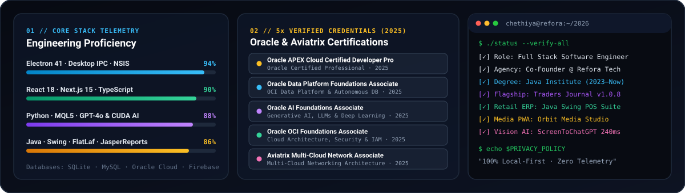

<!-- 2026 Custom Spatial SVG Hero Banner (Click to launch live portfolio) -->

 

<!-- Animated Typing Headline -->

<!-- Primary 2026 Quick-Action Navigation Bar -->

  
  
  
  
  
  

---

## 🍱 2026 Engineering Telemetry & Credentials

  

---

## 🚀 Flagship Production Systems (2026 Showcase)

<table>
  <tr>
    <td width="50%" valign="top">
      <h3>👑 <a href="https://github.com/damsarachethiyaa-dev/Traders-Journal">Traders Journal (KING Edition v1.0.8)</a></h3>
      

        
        
        
      

      
<strong>Privacy-first Windows desktop trading analytics workstation with real-time MetaTrader 5 synchronization.</strong>

      <ul>
        <li><strong>New in v1.0.8:</strong> Bundles a portable Python runtime inside the installer so live MT5 sync works out-of-the-box with zero manual setup.</li>
        <li>Includes multi-account authentication, cinema intro, interactive equity curves, PnL calendar, and KING risk radar.</li>
      </ul>
      
<code>Electron 41</code> · <code>Node.js</code> · <code>Python</code> · <code>MQL5</code> · <code>NSIS Installer</code>

      

        <a href="https://github.com/damsarachethiyaa-dev/Traders-Journal/releases/latest"><strong>⬇ Download v1.0.8 (.exe)</strong></a> &nbsp;·&nbsp;
        <a href="https://github.com/damsarachethiyaa-dev/Traders-Journal"><strong>🐙 Source Code →</strong></a>
      

    </td>
    <td width="50%" valign="top">
      <h3>🛒 <a href="https://github.com/damsarachethiyaa-dev/POS-Inventory-Management-System">POS &amp; Inventory Management Suite</a></h3>
      

        
        
        
      

      
<strong>Enterprise desktop Point of Sale (POS) and real-time Inventory ERP system with dynamic PDF reporting.</strong>

      <ul>
        <li>High-speed retail barcode checkout, automated stock deduction, and full customer/supplier CRM over MySQL.</li>
        <li>Integrated <strong>JasperReports</strong> engine for instant thermal receipts, sales logs, and executive PDF summaries.</li>
      </ul>
      
<code>Java</code> · <code>Swing</code> · <code>FlatLaf Dark UI</code> · <code>JasperReports</code> · <code>MySQL</code>

      

        <a href="https://github.com/damsarachethiyaa-dev/POS-Inventory-Management-System/releases/latest"><strong>⬇ Download Release (.zip)</strong></a> &nbsp;·&nbsp;
        <a href="https://github.com/damsarachethiyaa-dev/POS-Inventory-Management-System"><strong>🐙 Source Code →</strong></a>
      

    </td>
  </tr>
  <tr>
    <td width="50%" valign="top">
      <h3>🌌 <a href="https://github.com/damsarachethiyaa-dev/orbit-media-studio">Orbit Media Studio (Galaxy PWA)</a></h3>
      

        
        
      

      
<strong>Galaxy-inspired web and installable PWA workspace for smart video downloading, batch queues, and watermark removal.</strong>

      <ul>
        <li>Multi-platform HD video downloader, 192kbps audio extractor, and concurrent batch processing queue.</li>
        <li>Interactive region-based watermark removal and blurring studio powered by FFmpeg &amp; Docker.</li>
      </ul>
      
<code>Next.js 15</code> · <code>TypeScript</code> · <code>Tailwind CSS</code> · <code>FFmpeg</code> · <code>Docker</code>

      

        <a href="https://github.com/damsarachethiyaa-dev/orbit-media-studio"><strong>🚀 Explore Studio →</strong></a>
      

    </td>
    <td width="50%" valign="top">
      <h3>⚡ <a href="https://github.com/damsarachethiyaa-dev/Daybook">Daybook — FinTech Trading Journal</a></h3>
      

        
        
      

      
<strong>Minimalist desktop trading journal with integrated ForexFactory high-impact economic news and streak analytics.</strong>

      <ul>
        <li>Color-coded daily PnL calendar grid, win-streak fire animations, and custom accent color themes.</li>
        <li>Real-time high-impact macroeconomic news badges automatically aligned to local system timezone.</li>
      </ul>
      
<code>Electron</code> · <code>React 18</code> · <code>TypeScript</code> · <code>ForexFactory API</code> · <code>Tailwind CSS</code>

      

        <a href="https://github.com/damsarachethiyaa-dev/Daybook"><strong>🚀 View Repository →</strong></a>
      

    </td>
  </tr>
  <tr>
    <td width="50%" valign="top">
      <h3>🤖 <a href="https://github.com/damsarachethiyaa-dev/Screen-Capture">ScreenToChatGPT (AI Vision Assistant)</a></h3>
      

        
        
      

      
<strong>Instant multi-monitor screenshot capture utility with automated ChatGPT desktop injection and prompt presets.</strong>

      <ul>
        <li>Global hotkey <code>Ctrl + Alt + G</code> captures multi-monitor setups and injects directly into the Windows ChatGPT app.</li>
        <li>Built-in prompt presets for market order-flow analysis, key chart levels, and rapid code debugging.</li>
      </ul>
      
<code>Python</code> · <code>OpenAI GPT-4o</code> · <code>PyWin32</code> · <code>PyInstaller</code> · <code>Tkinter</code>

      

        <a href="https://github.com/damsarachethiyaa-dev/Screen-Capture"><strong>🚀 View Utility →</strong></a>
      

    </td>
    <td width="50%" valign="top">
      <h3>🏢 <a href="https://github.com/refora-technologies">Refora Technologies &amp; 4K AI Upscaler</a></h3>
      

        
        
      

      
<strong>Digital software agency &amp; engineering lab building bespoke enterprise systems, web portals, and GPU AI pipelines.</strong>

      <ul>
        <li>Umbrella organization behind <em>Traders Journal</em>, <em>Orbit Media Studio</em>, <em>Daybook</em>, <em>ScreenToChatGPT</em>, and enterprise client portals.</li>
        <li>Home to our CUDA-accelerated <strong>Real-ESRGAN 4K 60FPS</strong> deep-learning video super-resolution pipeline.</li>
      </ul>
      
<code>React</code> · <code>Next.js</code> · <code>Oracle Cloud</code> · <code>PyTorch CUDA</code> · <code>Real-ESRGAN</code>

      

        <a href="https://damsarachethiyaa-dev.github.io/github-portfolio/"><strong>🌐 Agency &amp; Portfolio →</strong></a> &nbsp;·&nbsp;
        <a href="https://github.com/refora-technologies"><strong>🐙 @refora-technologies →</strong></a>
      

    </td>
  </tr>
</table>

---

## 🛠️ Full-Stack Arsenal & Tooling

| Domain | Core Technologies & Frameworks |
| :--- | :--- |
| **🖥️ Desktop & Frontend** |       |
| **⚙️ Backend & Enterprise** |      |
| **🗄️ Data & Cloud Infrastructure** | -F80000?style=flat-square&logo=oracle&logoColor=white)     |
| **🤖 AI, FinTech & Media** | -00A651?style=flat-square&logo=tradingview&logoColor=white)     |
| **📱 Mobile & Cross-Platform** | -20232A?style=flat-square&logo=react&logoColor=61DAFB)    |

---

### 🤝 Let's Build the Next Flagship System Together

🌐 **[Interactive 2026 Portfolio](https://damsarachethiyaa-dev.github.io/github-portfolio/)** &nbsp;·&nbsp;
📧 **[damsara.chethiyaa@gmail.com](mailto:damsara.chethiyaa@gmail.com)** &nbsp;·&nbsp;
💬 **[WhatsApp (+94 70 247 0819)](https://wa.me/94702470819)** &nbsp;·&nbsp;
💼 **[LinkedIn](https://www.linkedin.com/in/chethiya-rathnasekara-40b0913b2)**

*"Plan the trade. Trade the plan. Engineer the future."* ⚡

